# QR Code Payment Platform

QR payment MVP: server, operations console and mobile application.

A merchant issues a secure, expiring QR code, the customer scans it, checks the merchant identity and confirms. The server guarantees a consistent payment, produces receipts and supports refunds. The payment provider is simulated and no money moves.

> **Structure only.** The source code is private. Source files here are intentionally empty so you can see how the project is organized. Commands describe the private codebase.

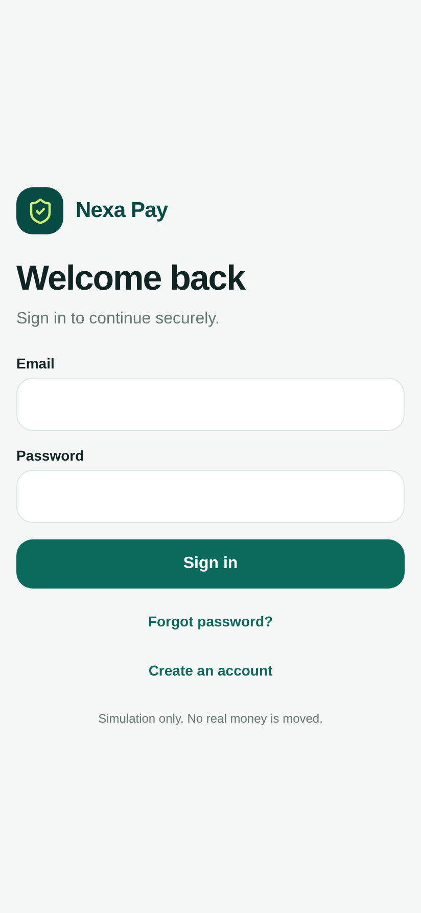

## Features

- Customer and merchant roles in one app
- Expiring single-use QR codes
- Receipts and refunds
- Live events
- Support and investigation tools
- Append-only audit

## Applications

| Application | Role |
| --- | --- |
| [API server](server/README.md) | Express modular monolith |
| [Operations console](admin/README.md) | React console with a same-origin session gateway |
| [Nexa Pay mobile](mobile/README.md) | Expo application for customers and merchants |

## Architecture

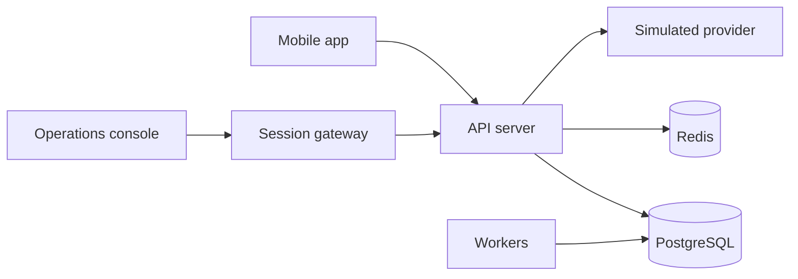

## Engineering highlights

- Idempotency keys and database constraints protect financial state
- Amounts are integers in centimes
- Crash recovery and lookup-only reconciliation
- Unit, integration, API, security and concurrency tests
- Browser never holds backend tokens: an encrypted session gateway does

## Screenshots

| Mobile sign in | Customer home |
| --- | --- |
|  | 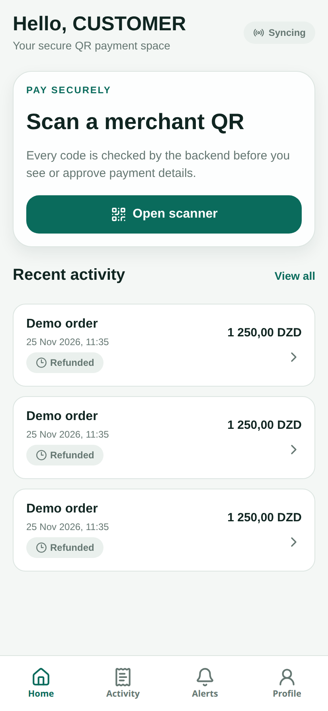 |
| **Merchant home** | **Create payment** |
| 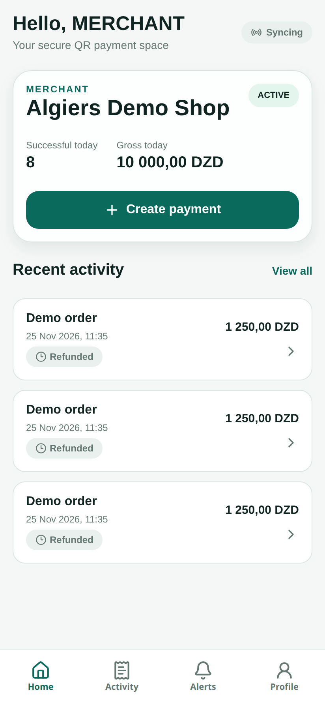 | 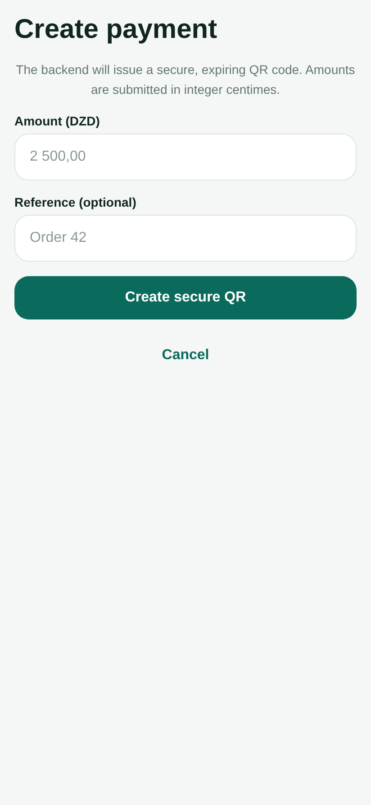 |
| **Operations overview** | **Transactions** |
| 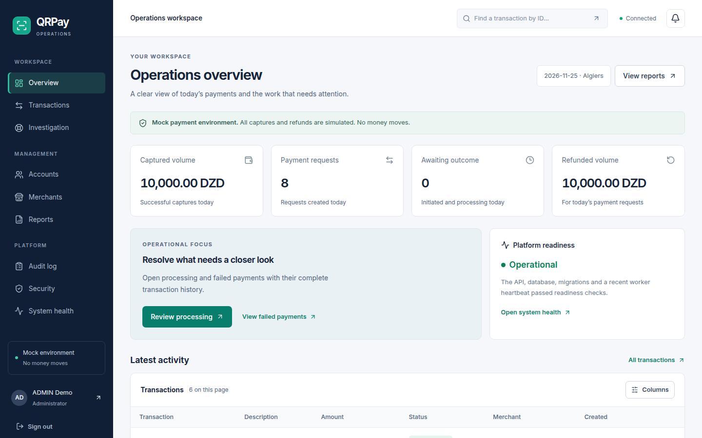 | 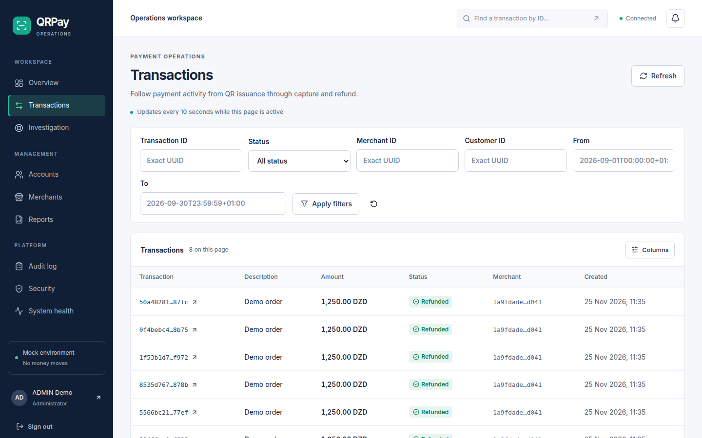 |
| **Transaction details** | **Reports** |
| 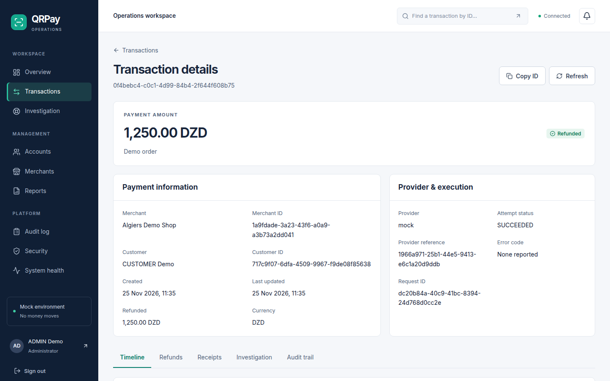 | 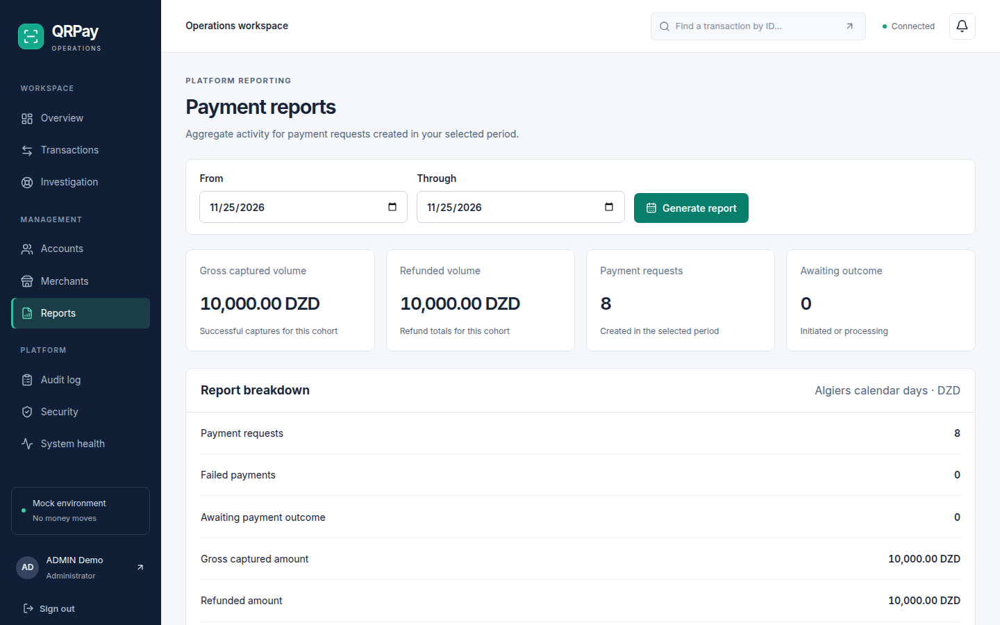 |
| **Audit log** | **Merchants** |
| 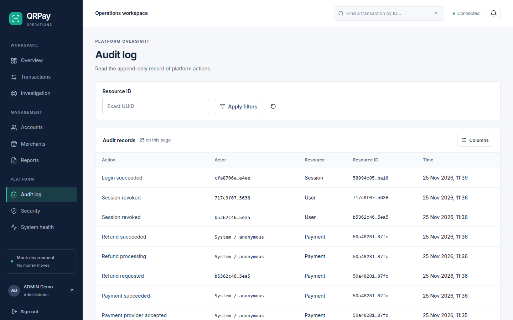 | 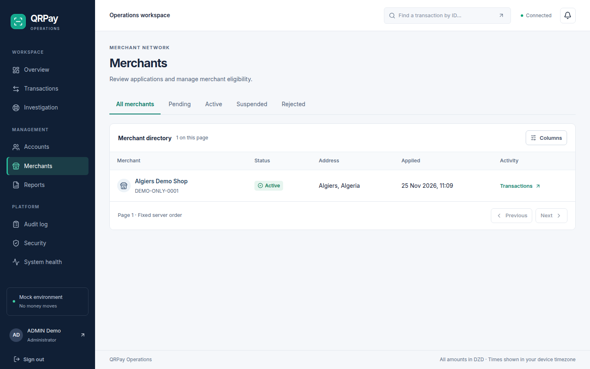 |
| **Accounts** | **System health** |
| 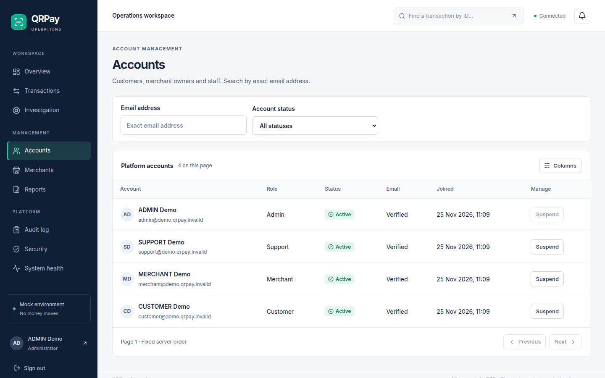 | 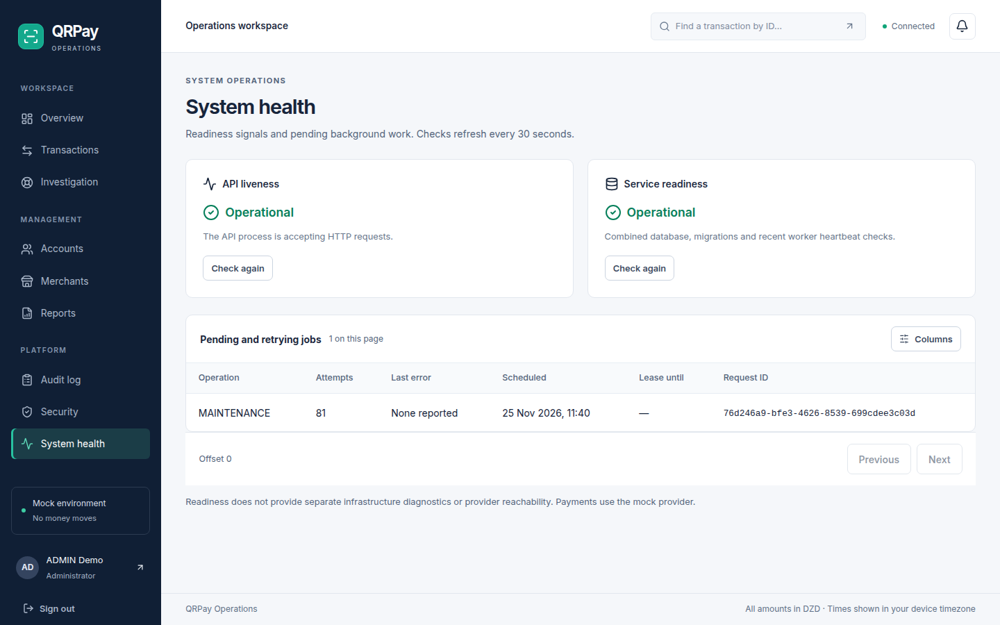 |

Screenshots show the real stack with generated demo payments. Mobile screens were captured from the web build with browser storage in place of the device secure store.

## Repository layout

```text
server/                                 Express modular monolith
admin/                                  React console with a same-origin session gateway
mobile/                                 Expo application for customers and merchants
docs/screenshots/
```

Each application has its own README with responsibilities, dependencies, structure and commands.

## Usage

Published for portfolio and presentation purposes. No license is granted for reuse.
