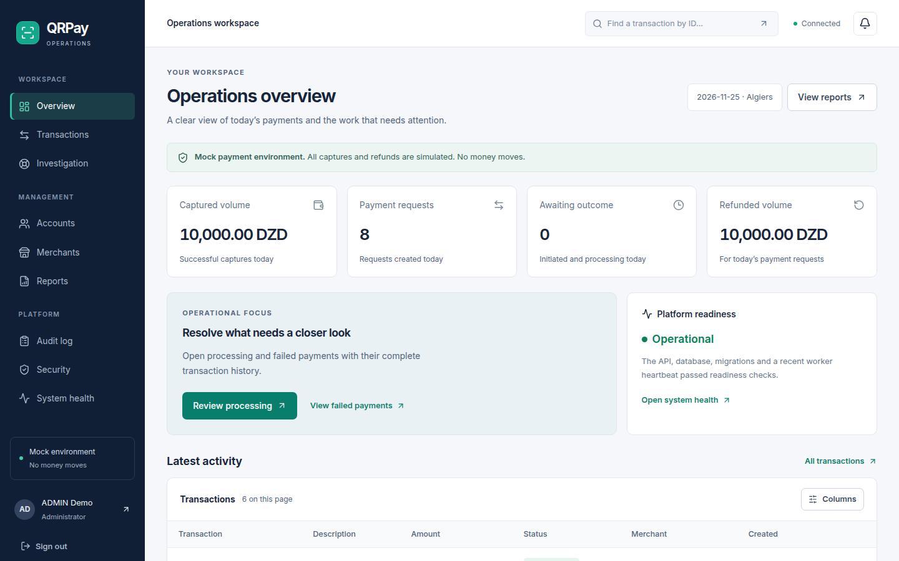
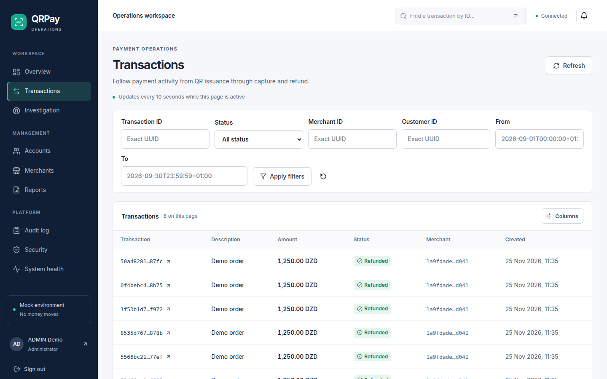
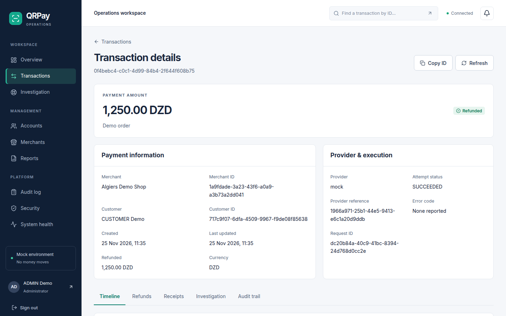
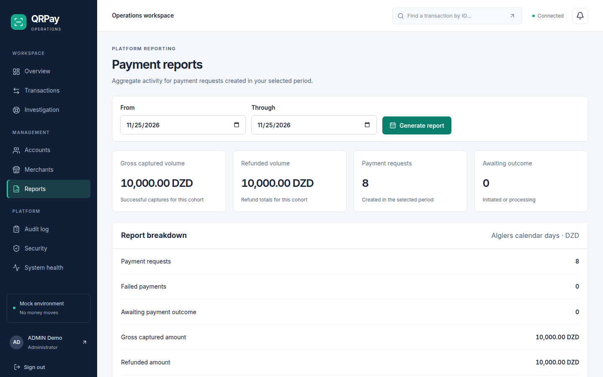
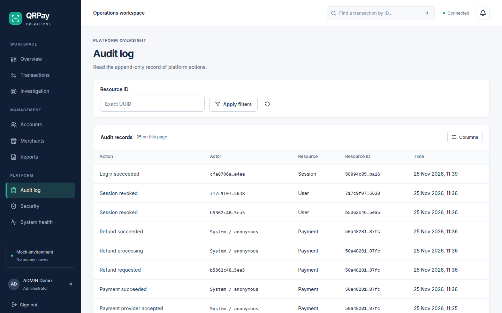
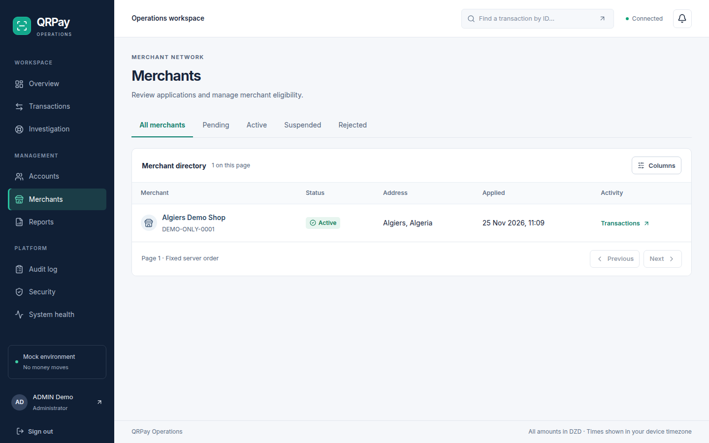
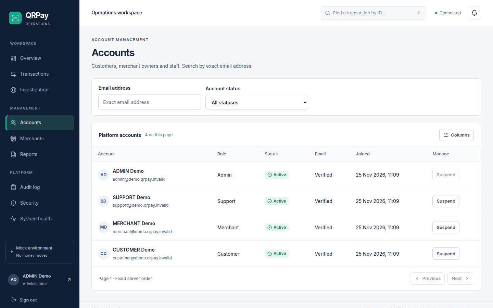
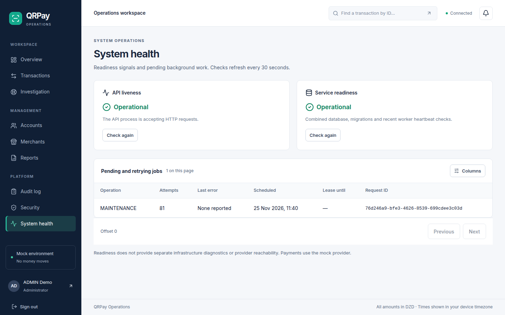

# Operations console

React console with a same-origin session gateway. Part of [QR Code Payment Platform](../README.md).

> **Structure only.** The source code is private. Source files here are intentionally empty so you can see how the project is organized. Commands describe the private codebase.

## Responsibilities

- Overview, transactions and investigation
- Accounts and merchants
- Reports, audit log and security events
- System health

## Screenshots

| Operations overview | Transactions |
| --- | --- |
|  |  |
| **Transaction details** | **Reports** |
|  |  |
| **Audit log** | **Merchants** |
|  |  |
| **Accounts** | **System health** |
|  |  |

## Main dependencies

`@fontsource-variable/inter`, `@radix-ui/react-dialog`, `@radix-ui/react-dropdown-menu`, `@radix-ui/react-slot`, `@tanstack/react-query`, `@tanstack/react-table`, `class-variance-authority`, `clsx`, `cookie`, `date-fns`, `dotenv`, `express`, `helmet`, `lucide-react`, `react`, `react-dom`, `react-hook-form`, `react-router-dom`, `socket.io`, `socket.io-client`, `sonner`, `tailwind-merge`, `ws`

## Structure

```text
deploy/                           1 file
docs/                             2 files
scripts/                          3 files
server/                           3 files
src/app/                          3 files
src/components/                   10 files
src/features/                     20 files
src/hooks/                        1 file
src/lib/                          6 files
src/                              1 file
src/styles/                       2 files
tests/                            7 files
```

## Commands

```bash
npm install
npm run dev
npm start
npm run build
npm test
npm run lint
```
