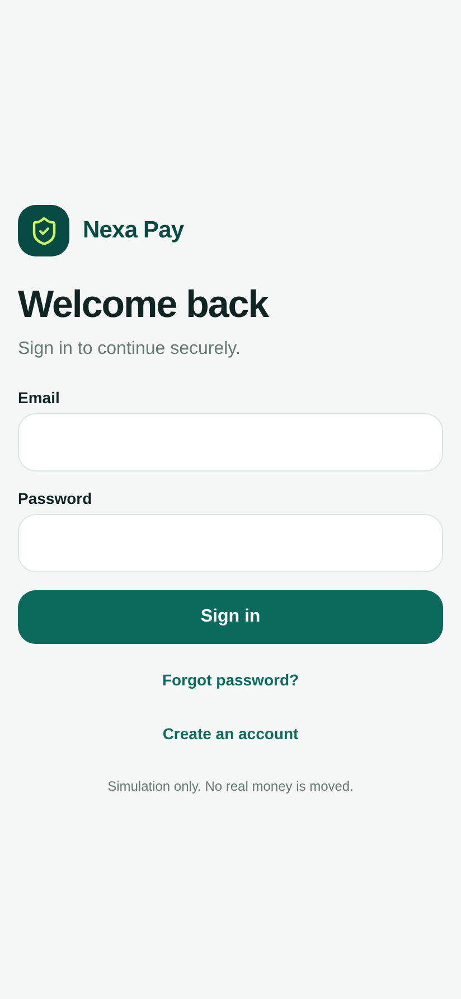
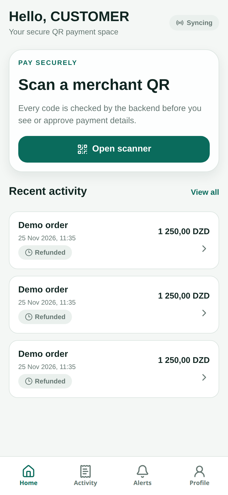
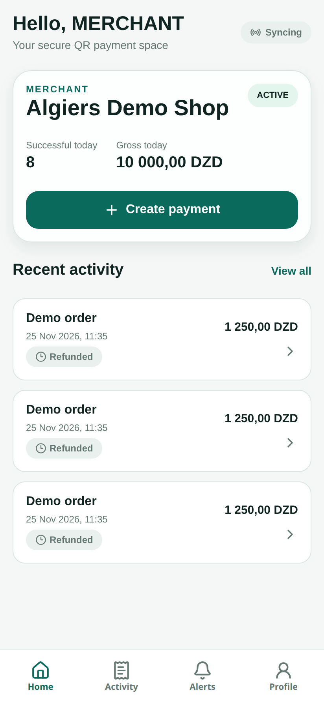
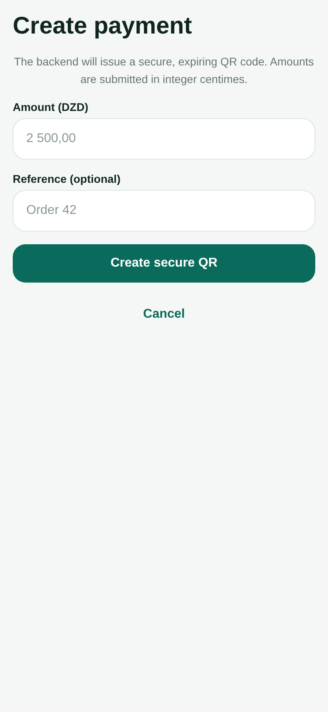

# Nexa Pay mobile

Expo application for customers and merchants. Part of [QR Code Payment Platform](../README.md).

> **Structure only.** The source code is private. Source files here are intentionally empty so you can see how the project is organized. Commands describe the private codebase.

## Responsibilities

- Camera scanning and payment confirmation
- Payment creation for merchants
- Receipts, activity and alerts
- Biometric lock and session management

## Screenshots

| Mobile sign in | Customer home |
| --- | --- |
|  |  |
| **Merchant home** | **Create payment** |
|  |  |

## Main dependencies

`@tanstack/react-query`, `date-fns`, `expo`, `expo-application`, `expo-camera`, `expo-constants`, `expo-crypto`, `expo-dev-client`, `expo-font`, `expo-haptics`, `expo-image`, `expo-linking`, `expo-local-authentication`, `expo-network`, `expo-router`, `expo-secure-store`, `expo-splash-screen`, `expo-status-bar`, `expo-system-ui`, `expo-web-browser`, `lucide-react-native`, `react`, `react-dom`, `react-hook-form`, `react-native`, `react-native-gesture-handler`, `react-native-reanimated`, `react-native-safe-area-context`, `react-native-screens`, `react-native-svg`, `react-native-web`, `react-native-worklets`

## Structure

```text
__tests__/                        7 files
assets/                           2 files
docs/                             4 files
e2e/                              1 file
scripts/                          1 file
src/app/                          23 files
src/components/                   10 files
src/constants/                    2 files
src/features/                     9 files
src/lib/                          8 files
src/providers/                    6 files
```

## Commands

```bash
npm install
npm start
npm test
npm run lint
npm run web
npm run android
```
